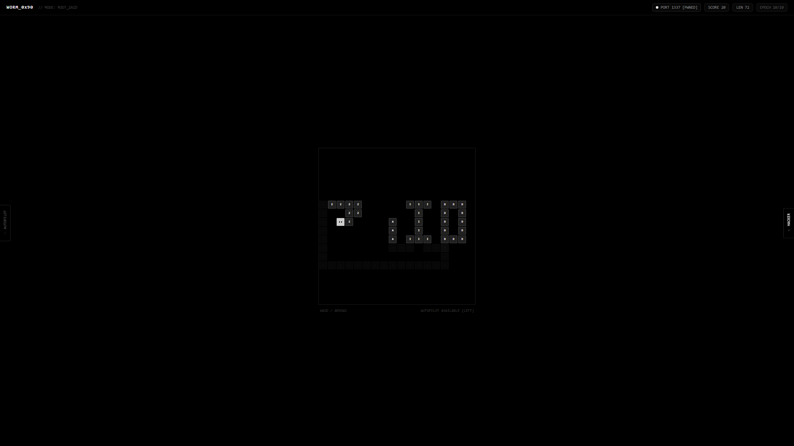

# CyberSnake // WORM_0x90 🐍⚡

> A retro arcade Snake game overhauled with an autonomous Deep Q-Learning (DQN) neural policy network, manic gameplay mods, and an interactive memory-exploitation CTF terminal on port 1337.



---

## 🎮 Features

- **Classic 8-Bit Arcade Core:** Responsive grid-based mechanics, score keeping, and high-frequency tick rates.
- **Autonomous Neural Policy Network:**
  - DQN Topology: `[8 : 6 : 6 : 3]` (8 spatial sensory inputs, 64-node ReLU hidden layers, 4 directional Q-value outputs).
  - 120 FPS decision loop with zero human intervention required.
  - Live policy training, weight evaluation, and loss tracking.
- **Chaos & Speed Mods:**
  - *Suicide Mode:* The snake enters a self-targeting loop, requiring frantic WASD intervention to evade lethal collision.
  - *Wall Phase (Ghost Mode):* NOPs boundary checks so the snake loops through walls seamlessly.
- **Security CTF & Root Escalation Terminal (Port 1337):**
  - Simulated low-privilege guest shell (`guest@matrix:~$`).
  - Requires probing memory offsets, finding the stack canary, and executing a buffer overflow exploit to attain **Ring 0 Master Root**.
- **The ZAID Signature Matrix:**
  - Once root access is achieved, the neural policy executes a 74-step continuous Manhattan traversal, carving the glowing **ZAID** signature matrix across the board.

---

## 🕹️ Quick Hack Tutorial (How to Unlock Cheats)

Open the terminal drawer on the right side of the screen:

1. **Scan Defenses:**
   ```bash
   ?scan
   ```
   *Identifies open debug port 1337 and stack canary protection.*

2. **Dump Memory Stack:**
   ```bash
   ?leak
   ```
   *Inspects memory registers and locates the canary offset at `+0x40` (`0x7FFE_0040`).*

3. **Trigger Buffer Overflow:**
   ```bash
   ?overflow 0x90909090
   ```
   *Smashes the stack canary, overwrites the return pointer (`EIP`), and grants **Ring 0 Root Privileges**.*

4. **Execute Root Commands:**
   ```bash
   ?help             # View all privileged kernel injection commands
   ?zaid             # Trigger the autonomous ZAID matrix slither
   ?suicide          # Engage manic self-targeting death-loop
   ?patch ghost      # Disable self-collision and phase through your own tail
   ?patch noclip     # Wrap boundaries across screen edges
   ```

---

## 🚀 Running Locally

Simply serve `index.html` with any static server or open it directly in any modern browser:

```bash
# Using python
python -m http.server 8080

# Using npx
npx serve .
```

Navigate to `http://localhost:8080` and enjoy!

---

## 👤 Author

**M. Zaid**
- GitHub: [@Coder-Zaid](https://github.com/Coder-Zaid)
